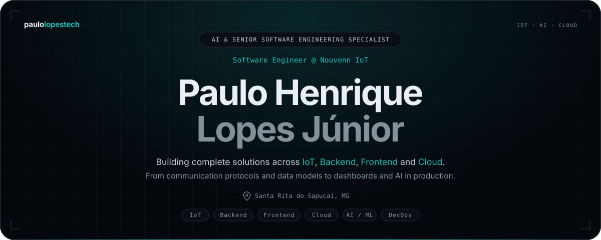
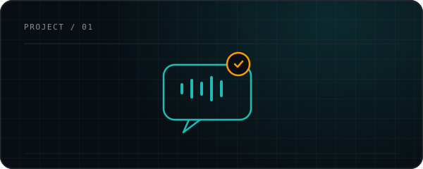
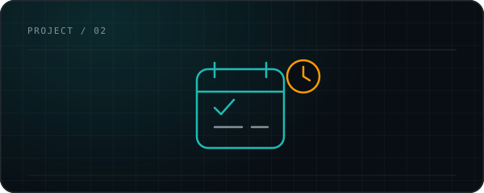
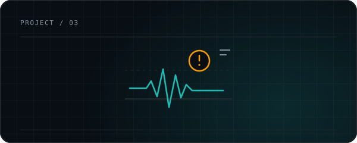
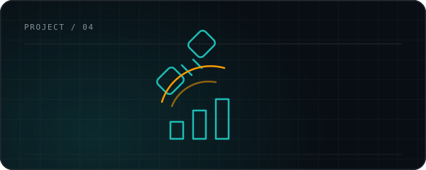

  

  &nbsp;
  &nbsp;
  &nbsp;
  &nbsp;
  

  
    <a href="#section-what-i-do">What I Do</a> &nbsp;·&nbsp;
    <a href="#section-skills">Skills</a> &nbsp;·&nbsp;
    <a href="#section-experience">Experience</a> &nbsp;·&nbsp;
    <a href="#section-projects">Projects</a> &nbsp;·&nbsp;
    <a href="#section-education">Education</a> &nbsp;·&nbsp;
    <a href="#section-contact">Contact</a>
  

## &nbsp; What I Do

<table width="100%">
  <tr>
    <td width="50%" valign="top">
        
      <strong>IoT end-to-end</strong> 
      Communication protocols, device management and real-time monitoring platforms.
    </td>
    <td width="50%" valign="top">
        
      <strong>Cloud &amp; DevOps</strong> 
      AWS/GCP architecture, Docker, CI/CD and cost/performance optimization.
    </td>
  </tr>
  <tr>
    <td width="50%" valign="top">
        
      <strong>AI in production</strong> 
      Machine learning models, LLMs, LangChain and AI agents applied to real data.
    </td>
    <td width="50%" valign="top">
        
      <strong>Product engineering</strong> 
      Software architecture, data modeling and technical leadership.
    </td>
  </tr>
</table>

## &nbsp; Skills &amp; Technologies

<table width="100%">
  <tr>
    <td width="50%" valign="top">
       <strong>Backend</strong> 
      <code>Node.js</code> <code>NestJS</code> <code>TypeScript</code> <code>JavaScript</code> <code>Python</code> <code>Java</code>
    </td>
    <td width="50%" valign="top">
       <strong>Frontend &amp; Mobile</strong> 
      <code>React</code> <code>Next.js</code> <code>React Native</code> <code>Flutter</code> <code>Electron</code>
    </td>
  </tr>
  <tr>
    <td width="50%" valign="top">
       <strong>AI &amp; Machine Learning</strong> 
      <code>Machine Learning</code> <code>LLMs</code> <code>LangChain</code> <code>AI Agents</code>
    </td>
    <td width="50%" valign="top">
       <strong>Messaging &amp; Protocols</strong> 
      <code>Apache Kafka</code> <code>gRPC</code> <code>MQTT</code> <code>WebSockets</code> <code>REST APIs</code>
    </td>
  </tr>
  <tr>
    <td width="50%" valign="top">
       <strong>Databases</strong> 
      <code>PostgreSQL</code> <code>MongoDB</code> <code>Redis</code> <code>SQL</code>
    </td>
    <td width="50%" valign="top">
       <strong>Cloud &amp; DevOps</strong> 
      <code>AWS</code> <code>GCP</code> <code>Docker</code> <code>GitHub Actions</code> <code>Jenkins</code> <code>Nginx</code> <code>Linux</code> <code>CI/CD</code>
    </td>
  </tr>
  <tr>
    <td width="50%" valign="top">
       <strong>Testing</strong> 
      <code>Jest</code> <code>automated testing</code>
    </td>
    <td width="50%" valign="top">
       <strong>Software Product</strong> 
      <code>Planning</code> <code>Modeling</code> <code>Architecture</code> <code>Product evolution</code> <code>Technical leadership</code>
    </td>
  </tr>
</table>

## &nbsp; Experience

<table width="100%">
  <tr>
    <td width="25%" valign="top"><code>Sep 2025 – Present</code></td>
    <td valign="top"><strong>Mid-Level Systems Development Analyst</strong>  Nouvenn IoT</td>
  </tr>
  <tr>
    <td width="25%" valign="top"><code>Feb 2025 – Sep 2025</code></td>
    <td valign="top"><strong>Junior Systems Development Analyst II</strong> Nouvenn IoT</td>
  </tr>
  <tr>
    <td width="25%" valign="top"><code>Jan 2025 – Mar 2025</code></td>
    <td valign="top"><strong>Technical Lead</strong> Independent Project</td>
  </tr>
  <tr>
    <td width="25%" valign="top"><code>Aug 2023 – Jan 2025</code></td>
    <td valign="top"><strong>Junior Systems Development Analyst</strong> Nouvenn IoT</td>
  </tr>
  <tr>
    <td width="25%" valign="top"><code>Feb 2022 – Jul 2023</code></td>
    <td valign="top"><strong>Software Development Internship</strong> Nouvenn IoT</td>
  </tr>
  <tr>
    <td width="25%" valign="top"><code>Feb 2021 – Jun 2022</code></td>
    <td valign="top"><strong>Development Core Trainee → Advisor</strong> CP2 Junior Company</td>
  </tr>
</table>

> **Selected impact**
>
> - Reduced software and cloud costs by up to **4x** through system and database optimization.
> - Built IoT platforms for lighting, gas, water and energy, with AI/ML models running on sensor data.
> - Implemented CI/CD pipelines and improved software delivery processes.
> - Led architecture decisions for an Anatel compliance system across cloud, backend, frontend and integrations.

## &nbsp; Selected Projects

<table width="100%">
  <tr>
    <td width="50%" valign="top">
      
        
      <strong>Help Me Pronounce</strong> 
      AI-powered English practice with real conversations and pronunciation feedback.  
      <code>React</code> <code>Next.js</code> <code>TypeScript</code> <code>AI</code>
    </td>
    <td width="50%" valign="top">
      
        
      <strong><a href="https://github.com/paulolopestech/study-plan-manager">Study Plan ↗</a></strong> 
      AI-generated study plans with goal and task tracking.  
      <code>Python</code> <code>FastAPI</code> <code>PostgreSQL</code> <code>Flask</code> <code>Docker</code>
    </td>
  </tr>
  <tr>
    <td width="50%" valign="top">
      
        
      <strong>Vibration Anomaly Detection</strong> 
      Prototype for detecting anomalies in industrial machine vibrations.  
      <code>Python</code> <code>Scikit-Learn</code> <code>Pandas</code> <code>NumPy</code>
    </td>
    <td width="50%" valign="top">
      
        
      <strong><a href="https://github.com/paulolopestech/SatStatClientServer">Sat Stat ↗</a></strong> 
      App Challenge 2023 app focused on statistics and analysis.  
      <code>React</code> <code>Node.js</code> <code>TypeScript</code>
    </td>
  </tr>
</table>

## &nbsp; Education &amp; Recognition

<table width="100%">
  <tr>
    <td width="50%" valign="top">
        
      <strong>B.Sc. in Computer Engineering</strong> 
      Inatel · 2020–2024
    </td>
    <td width="50%" valign="top">
        
      <strong>Recognition</strong> 
      ▹ Merit Scholarship — 1st place in the Inatel entrance exam 
      ▹ 1st place — Biochallenge "A technical look at the future" 
      ▹ 3rd place — Inatel App Challenge Hackathon 
      ▹ Academic Excellence Certificates · Keycloak · Agile Fundamentals
    </td>
  </tr>
  <tr>
    <td width="50%" valign="top">
        
      <strong>Teaching</strong> 
      Teaching assistant in Mathematics &amp; Calculus, Computer Architecture, Computer Networks and Software Engineering.
    </td>
    <td width="50%" valign="top">
        
      <strong>Languages</strong> 
      Portuguese (native) · English (fluent)
    </td>
  </tr>
</table>

## &nbsp; Contact

<h3 align="center">Let's connect</h3>

  &nbsp;
  &nbsp;
  &nbsp;
  &nbsp;
  

  Open to conversations about IoT, cloud, AI and software architecture.

